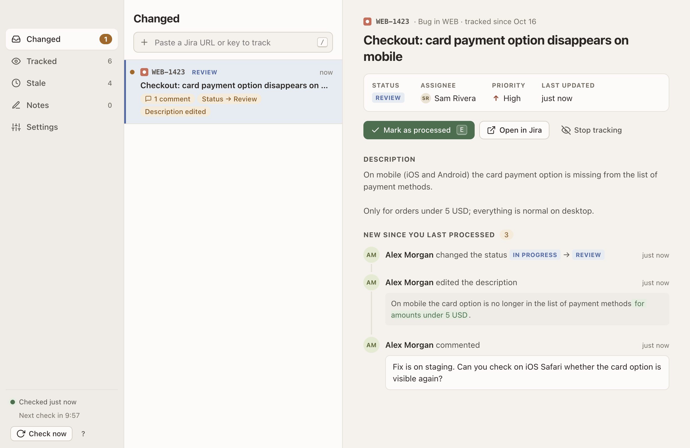

# IssueMon

A macOS desktop app (Electron) that watches Jira issues for you. Paste an issue URL or key; IssueMon checks periodically, notifies you and shows exactly *what* changed, and you tick changes off as *Processed*. It also lists **stale issues** for you and the colleagues you choose, and keeps short **notes** that become an issue with one click.

Tracking is separate from "watching" in Jira. The only thing IssueMon ever writes to Jira is an issue you create from a note.



## Install

**Requirements:** macOS 13 (Ventura) or later, on Apple silicon or Intel. A Jira **Cloud** site (`yourcompany.atlassian.net`) and an Atlassian API token. Jira Server and Data Center are not supported.

### Homebrew

```bash
brew install --cask fundament-agency/tap/issuemon
```

This taps and trusts `fundament-agency/homebrew-tap` in one step. The cask removes the quarantine flag from the app, so macOS doesn't block it, also after `brew upgrade --cask issuemon`.

### Download

Download the `.dmg` for your Mac (`arm64` for Apple silicon, `x64` for Intel) from the [Releases page](https://github.com/fundament-agency/issuemon/releases), open it and drag `IssueMon.app` to Applications.

### First launch

IssueMon is not notarized by Apple, so macOS blocks it once per `.dmg` install or upgrade (Homebrew removes the quarantine flag itself). Click *Done*, open **System Settings → Privacy & Security**, scroll to "IssueMon was blocked…", click **Open Anyway** and confirm. Control-click → *Open* no longer works since macOS 15. Or remove the quarantine flag in a terminal:

```bash
xattr -dr com.apple.quarantine /Applications/IssueMon.app
```

### Updates

IssueMon checks once a day for a newer release and tells you in the app; it never downloads or installs anything. Update with Homebrew or a new `.dmg`. See *Updates* in the table below, also for switching the check off.

## Getting started

On first start the connect screen asks for:

- **Jira URL**, e.g. `https://yourcompany.atlassian.net`
- **Email address** of your Atlassian account
- **API token**, created at [id.atlassian.com → Security → API tokens](https://id.atlassian.com/manage-profile/security/api-tokens)

After *Connect*, IssueMon suggests tracking your first issue: paste a URL or key into the paste field, or anywhere in the window (⌘V). More options are in **Settings**.

## What the app does

| Part | Behaviour |
|---|---|
| **Tracking** | Paste a URL (`/browse/ABC-1`, `?selectedIssue=ABC-1`), a key or several keys at once. A bare number (`123` or `#123`) gets the *default project*, also among full keys, as long as you paste only keys and numbers. Adding an issue records its current state; only later changes count. |
| **Checking** | Every 10 minutes (5, 10, 15, 30 or 60 configurable), 5 s after the Mac wakes up and on demand (⌘R). Moved issues are followed by id. When Jira is unreachable (no connection, a timeout, a server error), retries follow after 30 s, 1 and 2 minutes, then every 5 minutes or at the normal interval if that is shorter, until one succeeds. A `Retry-After` header from Jira makes the next check wait at least that long. |
| **Changed** | Status, comments, assignment (to you: highlighted), priority, description (word-level diff), attachments, labels, sprint and more, with author and time. Each edit to a comment is a change of its own, with the new text, marked word by word when IssueMon still has the old text; the chip *N comments edited* counts comments, not edits. New and edited comments that @-mention your Jira account get a *Mentions you* chip and row accent; the actual mention is highlighted in the timeline. Flags follow the connected Jira account, clear while reconnecting, and are recalculated for stored comments when the account becomes known or tracking is restored by Undo; older records without mention account ids stay unflagged. Responses still in flight from a previous account cannot replace the current identity or people list, mark issues missing, or notify. Plain text names, mentions of other accounts and description mentions do not count. Changed stays sorted by time. Only an issue's latest 100 comments are checked, so an edit to an older one goes unnoticed. Backlog order (*Rank*) and time tracking are ignored. A tracked issue that was deleted, or that you can no longer see, counts once as a change, *No longer accessible (deleted, or you no longer have access)*, with a notification; only an issue Jira leaves out of a real answer counts, never no connection, a timeout, a server error or a temporary error on that issue, and the first check after connecting or changing the account stays quiet. If the issue comes back, its error clears without a notification, and that change, if still open, is marked processed. The detail shows labels and fix versions when set, the parent key and summary, sub-tasks with a done count, linked issues with their relationship and status, and the description (long texts collapsed). Without new changes, it also shows the latest comment and change. Clicking a related key selects it if tracked, or offers *Track*. |
| **Tracked** | Finished issues (status category *Done*, such as Done or Closed) without open changes are grouped under *Done* at the bottom, collapsed by default. *Stop tracking* per issue and *Stop all* for the group, both undoable; nothing stops automatically, so an issue that was deleted or that you can no longer see keeps its red row (*Not found, or no longer accessible*), also after *Processed*, until you stop tracking it. Above five tracked issues, a filter on key, title, assignee or status appears. |
| **Processed** | Ticks off an issue's open changes (button or **E**); *Mark all processed* in Changed does it for every changed issue. Undoable. In Changed, the selection moves to the next changed issue. |
| **Own changes** | Not notified by default: stored as processed and marked *own change, not notified* in the timeline. Turn off *Don't notify my own changes* to test notifications with your own edits. |
| **Notifications** | One per changed issue, leading with the most important fresh pending change: assignment to you, then a mention of you, then an explicitly flagged risk change, then other changes; newest first within each kind. More than 3 changed issues give a single summary, counting issues assigned to you, mentioning you or with flagged risk changes, with those keys first in that order. An issue counts once per applicable kind. Changed keeps its time order. When the leading change is a comment mentioning you, its notification says who mentioned you and on which issue. Clicking one opens that issue's changes, also after a restart. *Send test notification* in Settings shows whether macOS displays notifications, or why not. macOS only shows notifications from a signed app: the development version (`npm start`) shows none, the built app does. |
| **Stale** | Query: `assignee = currentUser() AND statusCategory != Done AND updated <= -14d ORDER BY updated ASC`, so by default only your issues, and finished ones never count. Tick colleagues under *People* in Settings for `assignee IN (…)` with their account ids, and *Unassigned* for `(… OR assignee IS EMPTY)`; the list holds all active people on the site, without apps, customers and deactivated accounts. The Stale page filters on one or more of them, *Unassigned* included (nothing chosen = everyone), and remembers the filter. Configurable: days (1–365); excluded statuses such as Backlog or On hold (none by default; adds `AND status NOT IN (…)`; a status unknown to your Jira is skipped with a warning); excluded projects in one comma-separated field, by name or key, `*` matching any text (none by default; `ARCHIVE-*` skips every project whose name or key starts with ARCHIVE-). Sorted *Oldest first* by last update; the button next to the filter switches to *Newest first* and is remembered. Up to 1000 results. The detail shows the latest comment and change; *Track too* starts tracking the issue. |
| **Notes** | One-liners of at most 255 characters (long ones wrap). Add (Enter), edit (click the text; Enter saves, Esc reverts), tick off (struck through, not counted, cannot become an issue; reversible) and delete (undoable). New notes go on top; reorder by dragging the grip on the left or with `⌥↑`/`⌥↓` in the text. *Create issue* on any unticked note opens a panel below it to adjust the title, project (the notes project, else the default project) and type (*Task*, or its Dutch, French, German or Spanish name *Taak*, *Tâche*, *Aufgabe* or *Tarea*; else the first plain type; never an epic or sub-task). Nothing reaches Jira until *Create* or Enter; *Cancel* or Esc closes the panel. The issue lands in the backlog, the note disappears and the issue is tracked right away. |
| **Settings** | Account (Jira URL, email address, API token, *Test connection*); checking (interval, default project, start at login); notifications (on/off, *Don't notify my own changes*, *Send test notification*); appearance (theme, language); stale issues (people, unassigned, days, excluded statuses, excluded projects); notes (project for new issues, else the default project); about (version, *Check for updates once a day*, *Check now*). Every change is saved immediately. A Jira URL on another host clears the stored API token. A refused address (plain http to a non-local host) is not saved; the stored URL and token stay. |
| **Appearance** | Theme *System*, *Light* or *Dark*, in Settings → Appearance or the menu View → Theme; *System* follows macOS. A warm, soft palette: stone tints in light, warm anthracite in dark. |
| **Language** | English, Dutch, French, German and Spanish. *System* (the default) follows macOS and falls back to English. Change it in Settings → Appearance or the menu View → Language; it is stored with the settings and applies at once to the window, all menus (the standard Edit, View and Window items too), the menu bar icon and new notifications. Error messages and warnings from the last check follow within a second, or at the next attempt while IssueMon waits after a failed check. |
| **Background** | Closing the window keeps IssueMon checking in the menu bar. The number of changed issues shows in the menu bar and on the Dock icon; the menu bar icon's menu lists up to 10 changed issues, click one to open it. Optionally the app starts at login, in the background (built app only). |
| **Updates** | Once a day (first a minute after launch, and after waking when a day has passed) IssueMon asks GitHub for the latest release. If it is newer, a toast says *IssueMon 0.2.0 is available*, with *View release* (opens the release page in your browser) and *Later* (hides that version until a still newer one appears). Nothing is downloaded or installed: update with `brew upgrade --cask issuemon` or from the [Releases page](https://github.com/fundament-agency/issuemon/releases). *Check for Updates…* in the app menu (after *About*) and *Check now* in Settings → About check at once and answer with a toast: *You're up to date*, the update, or *Could not check for updates* (no connection, GitHub's rate limit; never a dialog). *Check for updates once a day* in Settings → About switches the daily check off. The development version never checks on its own; *Check now* always works. |

Shortcuts: `j`/`k` or `↑`/`↓` to browse, `e` for processed, `o` to open in Jira, `u` to stop tracking, `/` or `⌘K` to paste, `⌘L` to track an issue (via the menu), `⌘R` to check now, `⌘1`–`⌘4` for Changed, Tracked, Stale and Notes, `⌘,` for Settings, `⌘Z` to undo the last action (while its toast is visible), `Esc` to go back or close, `⌥↑`/`⌥↓` in a note to move it, and `?` for this overview in the app.

## Storage and privacy

- All data, the API token included, lives in `~/.issuemon/issuemon.json`, readable only by you (file mode 0600, folder 0700; wider permissions on an existing folder or file are tightened). The token never reaches the renderer, but any program running under your account can read the file. Only Electron's own files, such as caches, live in `~/Library/Application Support/IssueMon`.
- The token is only sent to the site it was entered for; changing the Jira URL to another host clears it.
- Nothing is stored in the macOS keychain, and Chromium's *IssueMon Safe Storage* key is not used (`use-mock-keychain`), so macOS never shows a keychain prompt for IssueMon.
- The User-Agent is always `IssueMon/<version>`: Jira Cloud rejects `POST` requests with a browser User-Agent (`403 XSRF check failed`).
- Network traffic goes only to your own Jira site over https (plain http is refused, except for `localhost`, `127.0.0.1` and `[::1]` for testing), via these Jira Cloud REST API v3 endpoints, plus the update check:
  - `issue` (create, only via *Create issue*)
  - `issue/createmeta/{project}/issuetypes`
  - `issue/bulkfetch`
  - `issue/{key}/changelog`
  - `issue/{key}/comment`
  - `search/jql`
  - `myself`
  - `users/search` (the list of people for Stale, at most once an hour)
- The update check asks `https://api.github.com/repos/fundament-agency/issuemon/releases/latest` once a day, sending only the User-Agent `IssueMon/<version>` and nothing about you or your Jira (GitHub sees your IP address, as with any request). Nothing is downloaded. *Check for updates once a day* in Settings → About switches it off.

## Development

### Running from source

```bash
npm install
npm start
```

Use the Node version in `.nvmrc`. The development version shows no notifications and never checks for updates on its own.

### Mock Jira

To try the app without a real Jira:

```bash
npm run mock-jira
```

Connect with URL `http://localhost:4778`, email `demo@example.com`, token `demo`. Trigger changes at <http://localhost:4778/__mock>, then *Check now* (⌘R) in IssueMon. `PORT=<port> npm run mock-jira` uses another port.

### Tests

```bash
npm test            # unit and integration tests, against the mock Jira
npm run test:e2e    # drives the real app via Playwright through all flows; screenshots in e2e/screenshots/
ISSUEMON_APP=dist/mac-arm64/IssueMon.app/Contents/MacOS/IssueMon npm run test:e2e   # same, against the built app (npm run pack)
npm run icons       # regenerate the icons from SVG (scripts/make-icons.js)
```

On GitHub, the e2e tests run both from source and against the built Apple silicon app, which keeps fewer languages and has no SwiftShader (see *Building an app*); the release workflow tests the app it uploads.

`test/i18n.test.js` checks that every catalog in `src/shared/locales/` has exactly the keys of `en.js`, with the same plural forms and placeholders, and is translated. UI text lives only in those catalogs.

### Project layout

```
src/
  main/      main.js (window, menu bar, notifications, IPC) · tracker.js (tracking and change detection)
             jira.js (REST client) · changes.js (Jira → changes, pure functions) · store.js (JSON storage)
             paths.js (where the data file lives) · secrets.js (API token in the data file)
             ipc.js (table channel → Tracker method, with the argument coercions)
             updates.js (the daily check for a newer release on GitHub; notify only)
  preload/   preload.js: the only bridge to the page (window.issuemon)
  renderer/  index.html, app.js, base.css, app.css: the interface ("Inbox" layout) · actions.js: optimistic updates and
             Undo, without DOM · reveal.js: completes a row's smooth scroll across renders
  shared/    keys.js: recognising issue keys · diff.js: word-level diff · inbox.js: the Changed, Tracked/Done and Stale lists,
             counts and selection · change.js: a change in words (labels, "assigned to you", notification and chip text) ·
             rules.js: note and project rules, intervals, themes, connected check, default issue type ·
             i18n.js: languages, the system-language fallback and the translator t(key, params) with plurals ·
             locales/: one message catalog per language (en.js is the source, nl.js …); all shared by main and renderer
  assets/    app and menu bar icons (generated by npm run icons)
scripts/     make-icons.js: renders the icons in build/ and src/assets/ from SVG · after-pack.js: trims the built app before signing
             artifact-build-completed.js: the .tar.xz next to each .dmg, and LZMA for the .dmg · verify-archives.sh: checks both
test/        node:test tests + support/mock-jira.js
e2e/         Playwright tests of the real Electron app
```

### Environment variables

For tests:

- `ISSUEMON_HOME`: another data folder (default `~/.issuemon`)
- `ISSUEMON_USER_DATA`: another folder for Electron's own files; without `ISSUEMON_HOME` the data file lives there too
- `ISSUEMON_TOKEN`: token from the environment, not stored
- `ISSUEMON_E2E=1`: notifications and external links are recorded instead of shown or opened, the daily update check does not run, and the window may exceed the screen so small displays get the desktop layout
- `ISSUEMON_UPDATE_URL`: another address for the update check's "latest release" request (default `https://api.github.com/repos/fundament-agency/issuemon/releases/latest`); the mock Jira answers at `/__releases/latest` with the running version unless a test sets `jira.release`
- `ISSUEMON_APP`: path to the executable of a built app for `npm run test:e2e`

### Building an app

```bash
npm run dist
```

This produces four assets in `dist/`:

- `issuemon-<version>-arm64.dmg` and `issuemon-<version>-arm64.tar.xz` (Apple silicon)
- `issuemon-<version>-x64.dmg` and `issuemon-<version>-x64.tar.xz` (Intel)

The `.tar.xz` holds the same app as the `.dmg` and is what Homebrew installs. `scripts/artifact-build-completed.js` writes it and compresses the `.dmg` with LZMA (macOS 10.15 and later); `scripts/verify-archives.sh arm64 x64` checks both the way the release workflow does.

Open a `.dmg` and drag `IssueMon.app` to Applications. `npm run pack` builds without an installer, to `dist/mac-arm64/IssueMon.app` (Intel: `dist/mac/IssueMon.app`).

The app keeps Chromium's resources only for its own five languages, plus British English and Latin American Spanish, which macOS picks for regional variants such as en-AU or es-MX (`electronLanguages` in `package.json`). On a Mac in another language IssueMon falls back to English with en-GB dates; Chromium's few own texts, such as form-validation messages, then come in English or in a later macOS language that it has. `scripts/after-pack.js` also removes SwiftShader, the software Vulkan that Chromium only uses for WebGL without a GPU; IssueMon draws no WebGL, and without a GPU the window is drawn in software.

Electron downloads its own files on first use; `npm run pack` and `npm run dist` fetch them first (`install-electron`), because the build copies Electron's licence notices from them and stops if one is missing.

The app is *ad-hoc* signed and not notarized. Built locally, it just starts; on another Mac, macOS blocks it the first time, see *First launch*.

## Contributing and security

Contributions are welcome: read [CONTRIBUTING.md](CONTRIBUTING.md) first. To report a vulnerability, follow [SECURITY.md](SECURITY.md) and do not open a public issue.

## License

MIT, see [LICENSE](LICENSE). Copyright © 2026 Fundament.
